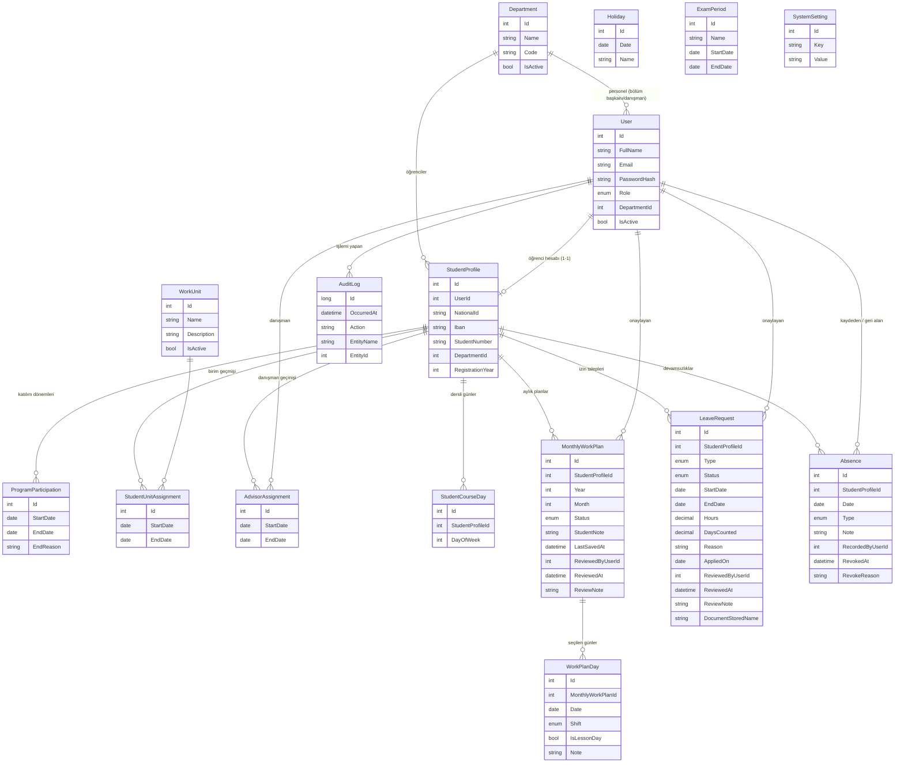

# Veritabanı (SQLite + EF Core Code-First)

## Tablolar



## Benzersizlik ve bütünlük kuralları (veritabanı seviyesinde)

| Kural | Mekanizma |
|---|---|
| E-posta, TC, öğrenci no, bölüm kodu/adı, birim adı benzersiz | Unique index |
| Öğrencinin aynı anda tek açık katılımı / birimi / danışmanı | Filtreli unique index `WHERE "EndDate" IS NULL` |
| Geçmişi olan kayıt silinemez | Tüm FK'lar `Restrict` |
| Rol okunabilir | `UserRole` metin olarak saklanır |
| Öğrencinin bir ay için tek planı | Unique index (öğrenci, yıl, ay) |
| Bir planda aynı gün tek kez | Unique index (plan, tarih) |
| Aynı tarih iki kez tatil olamaz | Unique index (tarih) |
| Öğrencinin bir günde tek aktif devamsızlığı | Filtreli unique index `WHERE "RevokedAt" IS NULL` |
| Ayar anahtarı tektir | Unique index (Key) |

## Sonraki aşamalarda eklenecek tablolar

Devam kayıtları ve QR oturumları, görevler ve danışman değerlendirmeleri.

## Migration

Her aşamada model değişince yeni bir migration eklenir:

```
dotnet tool install --global dotnet-ef
dotnet ef migrations add <Ad> --project src/IskurAuto.Data --startup-project src/IskurAuto.API
```

Uygulama açılırken migration varsa `Migrate()`, yoksa `EnsureCreated()` çalışır.
