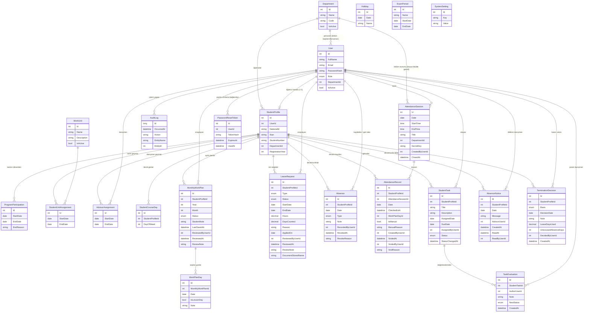

# Veritabanı (SQL Server + EF Core Code-First)

## Tablolar



## Benzersizlik ve bütünlük kuralları (veritabanı seviyesinde)

| Kural | Mekanizma |
|---|---|
| E-posta, TC, öğrenci no, bölüm kodu/adı, birim adı benzersiz | Unique index |
| Öğrencinin aynı anda tek açık katılımı / birimi / danışmanı | Filtreli unique index `WHERE [EndDate] IS NULL` |
| Geçmişi olan kayıt silinemez | Tüm FK'lar `Restrict` |
| Rol okunabilir | `UserRole` metin olarak saklanır |
| Öğrencinin bir ay için tek planı | Unique index (öğrenci, yıl, ay) |
| Bir planda aynı gün tek kez | Unique index (plan, tarih) |
| Aynı tarih iki kez tatil olamaz | Unique index (tarih) |
| Öğrencinin bir günde tek aktif devamsızlığı | Filtreli unique index `WHERE [RevokedAt] IS NULL` |
| Aynı öğrencinin aynı oturumda tek geçerli devam kaydı | Filtreli unique index `WHERE [VoidedAt] IS NULL` |
| Aynı danışman aynı öğrenci ve gün için tek devamsızlık bildirimi | Unique index (danışman, öğrenci, tarih) |
| Değerlendirmesi olan görev silinemez | FK `Restrict` |
| İlişik kesme kararı silinemez, öğrenci kaydına bağlıdır | FK `Restrict` |
| Sıfırlama jetonu tektir; jetonun kendisi değil özeti saklanır | Unique index (TokenHash) |
| Ayar anahtarı tektir | Unique index (Key) |

## Raporlar

Raporlar için ayrı tablo yoktur; hepsi yukarıdaki kayıtlardan istek anında hesaplanır.

## SQL Server notları

- Varsayılan bağlantı: `Server=(localdb)\MSSQLLocalDB;Database=IskurAuto;Trusted_Connection=True;TrustServerCertificate=True` (Visual Studio ile gelen LocalDB). Kurumsal sunucuda `ConnectionStrings:IskurAutoDb` ile değiştirilir.
- Hiçbir ilişkide cascade delete yoktur; kayıtlar silinmez, tarihçe tutulur.
- "Açık dönem tek olsun" (`EndDate IS NULL`), "iptal edilmemiş kayıt tek olsun" (`VoidedAt IS NULL`, `RevokedAt IS NULL`) kuralları filtreli benzersiz indekslerle veritabanında da güvence altındadır.
- Ondalık alanlar (`Hours`, `DaysCounted`, `LeaveDaysUsed`) `decimal(5,2)` tutulur.
- Tablo alanlarının tam listesi `teslim/3_Veritabani/04_tablo_sozlugu.md` içindedir.

## Migration

Depoda hazır migration yoktur. Uygulama ilk açılışta veritabanını ve tabloları kendisi oluşturur (`EnsureCreated`).
Migration ile ilerlemek isteyen geliştirici ilk migration'ı üretir ve dosyaları depoya ekler:

```
dotnet tool install --global dotnet-ef
dotnet ef migrations add InitialCreate --project src/IskurAuto.Data --startup-project src/IskurAuto.API
```

Bundan sonra model değiştikçe `dotnet ef migrations add <Ad>` ile yeni migration eklenir. Uygulama açılırken
migration varsa `Migrate()` çalışır. Önemli: veritabanı daha önce `EnsureCreated` ile oluştuysa, ilk migration'ı
uygulamadan önce veritabanı silinmelidir (`dotnet ef database drop --project src/IskurAuto.Data --startup-project src/IskurAuto.API`).
