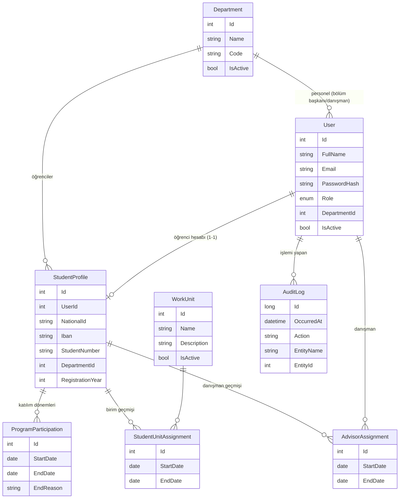

# Veritabanı (SQLite + EF Core Code-First)

## Aşama 1'de var olan tablolar



## Benzersizlik ve bütünlük kuralları (veritabanı seviyesinde)

| Kural | Mekanizma |
|---|---|
| E-posta, TC, öğrenci no, bölüm kodu/adı, birim adı benzersiz | Unique index |
| Öğrencinin aynı anda tek açık katılımı / birimi / danışmanı | Filtreli unique index `WHERE "EndDate" IS NULL` |
| Geçmişi olan kayıt silinemez | Tüm FK'lar `Restrict` |
| Rol okunabilir | `UserRole` metin olarak saklanır |

## Sonraki aşamalarda eklenecek tablolar (planlanan)

`WorkPlan` / `WorkPlanDay` (aylık plan, gün durumu), `Holiday` ve `CourseSchedule` (kurallar), `LeaveRequest` ve `Absence`
(izin/devamsızlık, limit `SystemSetting` tablosunda), `QrSession` ve `Attendance` (30 sn QR + devam), `TaskAssignment` ve
`AdvisorEvaluation` (görev/değerlendirme). Her biri aşama sırasında bu belgeye eklenecektir.

## Migration

Bu depoda migration dosyası **yoktur** (eski model değiştiği için silindi). İlk kurulumda üretilir:

```
dotnet tool install --global dotnet-ef
dotnet ef migrations add InitialCreate --project src/IskurAuto.Data --startup-project src/IskurAuto.API
```

Uygulama açılırken migration varsa `Migrate()`, yoksa `EnsureCreated()` çalışır.
