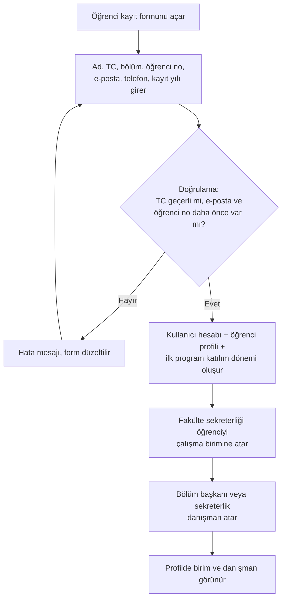
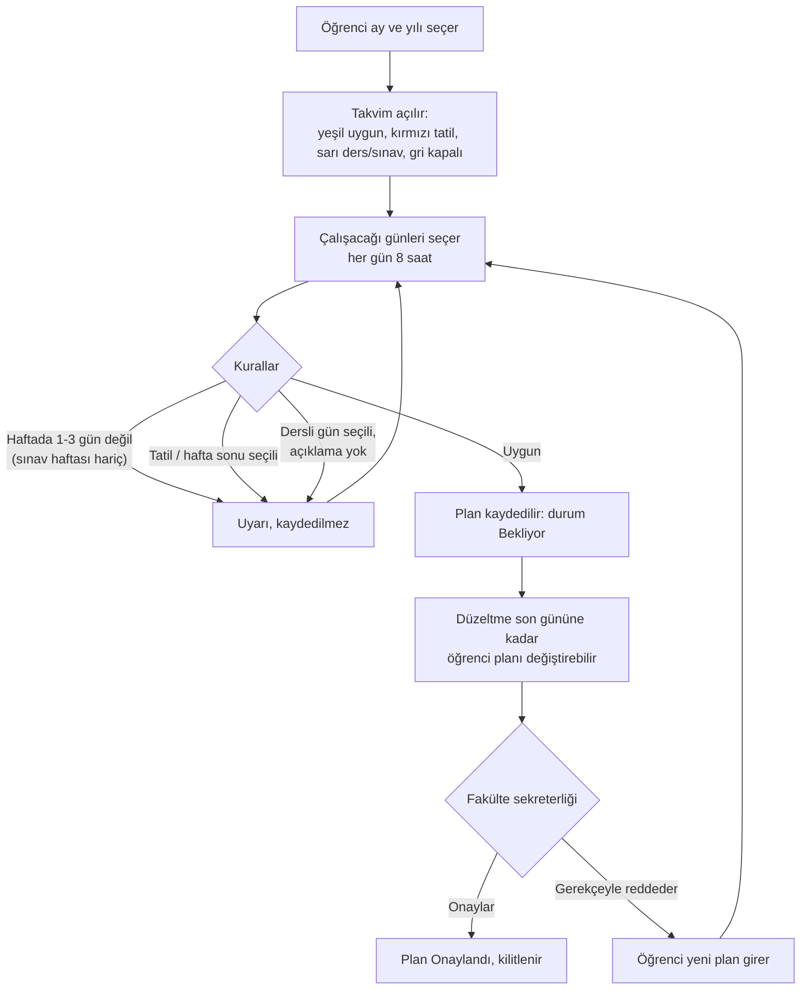
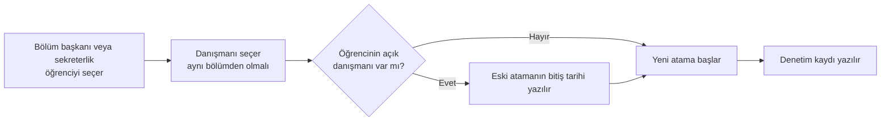
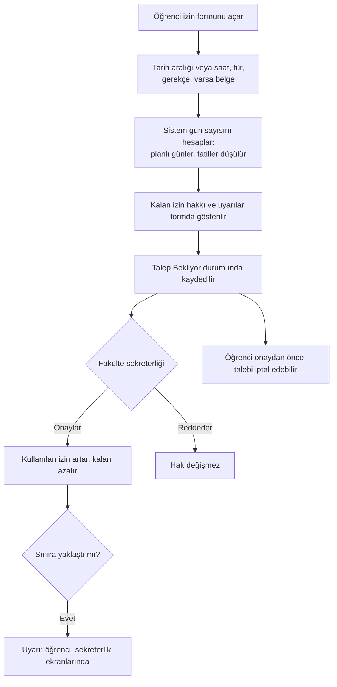
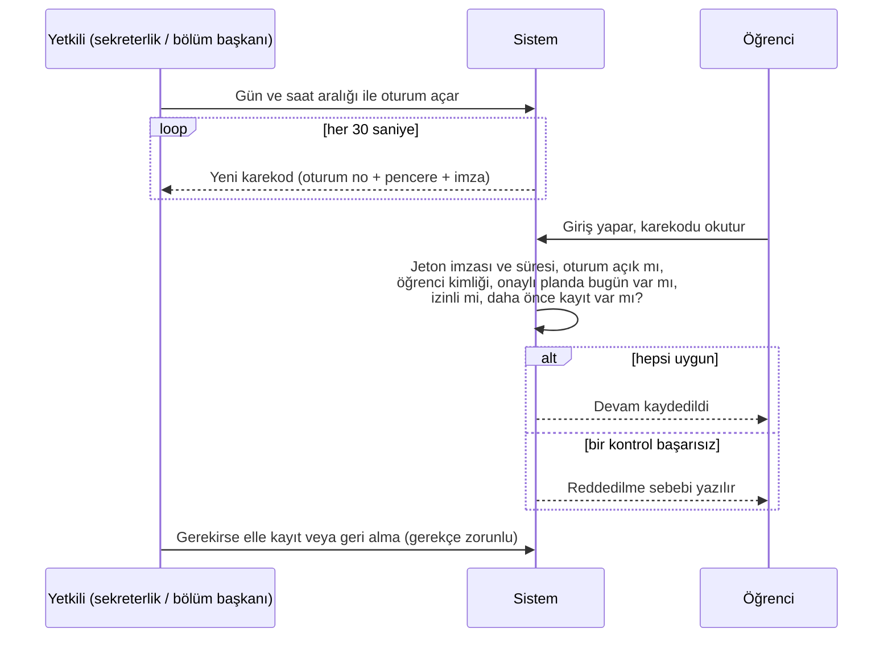
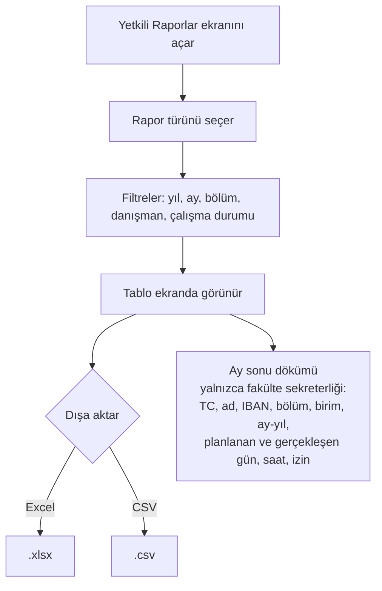
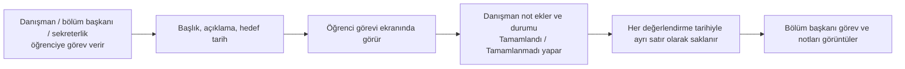
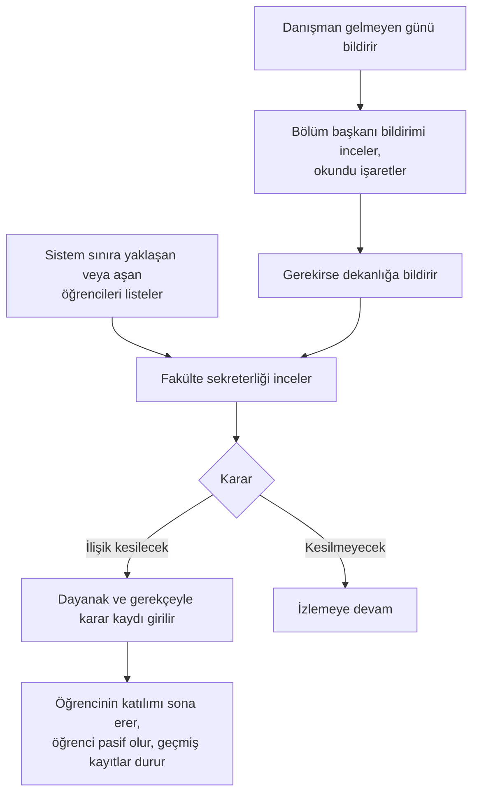

# İş akışları

Akışlar Mermaid ile yazılmıştır; GitHub ve Visual Studio Code (Markdown önizleme) üzerinde çizim olarak görünür.

## 1. Öğrenci kaydı

İlk kayıtta birim ve danışman girilmez; belgede istendiği gibi atamalar yapıldıktan sonra profilde görünür.
Her atama tarihli bir satırdır; değiştirilince eski satır kapanır, geçmiş korunur.

## 2. Aylık çalışma planı

Hafta, perşembe gününün düştüğü aya sayılır. Önceki ayların planları ayrı kayıt olarak korunur
(öğrenci, yıl, ay üçlüsü benzersizdir).

## 3. Danışman ataması

## 4. İzin

Toplam izin hakkı (varsayılan 10 gün), uyarı eşikleri ve sağlık izninin haktan düşüp düşmeyeceği ayarlardan
değiştirilir; kod değişmez.

## 5. Karekodla devam

Karekod fotoğrafı bir sonraki pencerede geçersizdir. Aynı öğrenci aynı oturumda ikinci kez kayıt yapamaz.
Planlı ama devamı olmayan gün kendiliğinden devamsızlık sayılmaz; karşılaştırmada "kayıt yok" görünür ve devamsızlığı
fakülte yönetimi girer.

## 6. Raporlama

Çalışma saati = onaylı plandaki günlerden devam kaydı olanların sayısı × 8 saat.

## 7. Görev ve değerlendirme

## 8. Devamsızlık bildirimi ve ilişik kesme

Sistem yalnızca inceleme listesi üretir; karar yetkili kişiye aittir.
